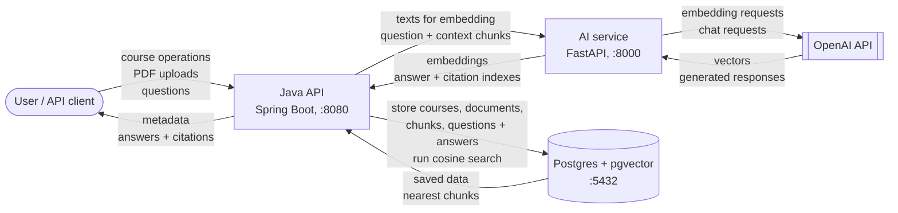

# NoteStream

[](https://github.com/achraf-hh/notestream/actions/workflows/ci.yml)

Upload your course PDFs, then ask questions about them and get answers with citations back to the source material. It's a small retrieval-augmented-generation (RAG) setup: the PDFs get split into chunks, each chunk is turned into a vector, and a question is answered by pulling the closest chunks and handing them to an LLM.

I built it to get hands-on with vector search and to keep a Java service and a Python service talking to each other in a way that's actually reproducible.

## How it fits together



- **Java API** handles courses, PDF ingestion, and the question/answer flow. It parses PDFs, stores chunks, and runs the vector similarity search.
- **AI service** is a thin Python wrapper around OpenAI. It does two things: turn text into embeddings, and answer a question given some context chunks.
- **Postgres/pgvector** holds everything and does the nearest-neighbour search with the `<=>` cosine operator.

Splitting the AI part into its own service keeps the OpenAI-specific code out of the Java side. If I ever swap OpenAI for a local model, only the Python service changes.

## Running it

You only need Docker. No local Java, Python, or Postgres install.

```bash
git clone <repo-url>
cd notestream
cp .env.example .env        # then put a real OpenAI key in it
docker compose up --build
```

First run pulls images and downloads dependencies, so give it a few minutes. After that the API is on `http://localhost:8080`.

The database schema is created automatically on startup by Flyway (`backend-java/src/main/resources/db/migration`), including the pgvector extension. Data lives in a Docker volume and survives restarts. To start from a clean database:

```bash
docker compose down -v
```

## API

Base URL `http://localhost:8080`.

Courses

- `POST   /api/courses` - create a course (`{"name": "...", "description": "..."}`)
- `GET    /api/courses` - list courses
- `GET    /api/courses/{id}` - one course
- `DELETE /api/courses/{id}` - delete a course and its documents

Documents

- `POST /api/courses/{courseId}/documents` - upload a PDF (multipart, field `file`, max 10 MB)
- `GET  /api/courses/{courseId}/documents` - list a course's documents
- `GET  /api/documents/{documentId}` - document metadata
- `GET  /api/documents/{documentId}/chunks` - the chunks a document was split into

Questions

- `POST /api/courses/{courseId}/questions` - ask a question (`{"question": "..."}`), returns the answer and cited chunks
- `GET  /api/courses/{courseId}/questions` - past questions and answers for a course

Health

- `GET /health` - API health (the Java service and the AI service each expose one)

## What happens on upload

1. PDFBox extracts the text page by page, and the text is split into chunks of about 500 characters with a 50-character overlap. A chunk ends at a sentence boundary when one is close, so chunks can run up to about 550 characters (`PdfParsingService.streamChunks`).
2. Each chunk is saved, then all of the document's chunks are sent to the AI service in one call to get 1536-dimension embeddings (`text-embedding-3-small`).
3. The embeddings are stored on the chunk rows. The whole upload runs in one database transaction, so if embedding fails, nothing is saved.

The upload request is synchronous: it returns once the document is chunked and embedded. The original PDF isn't kept.

## What happens on a question

1. The question is embedded the same way.
2. Postgres returns the 5 closest chunks in that course by cosine distance (`ChunkRepository.findSimilarChunks`); the embedding column has an HNSW index. The number is the `rag.retrieval-limit` setting, `RAG_RETRIEVALLIMIT` as an environment variable.
3. Those chunks plus the question go to the AI service. It numbers the chunks and asks `gpt-4o-mini` (temperature 0.3) to answer using only that context and to cite chunks as `[0]`, `[1]`, ...
4. The cited numbers are mapped back to real chunks, and the answer is stored with its citations.

## Measuring retrieval

`notestream-ai/eval/` is a small harness for measuring whether retrieval finds the right chunks:

- **Corpus:** five distributed-systems papers (MapReduce, GFS, Dynamo, Raft, ZooKeeper), downloaded from their original publishers and pinned by SHA-256 in `eval/corpus/manifest.yaml`. The PDFs aren't committed.
- **Golden dataset:** `eval/datasets/distributed-systems/questions.yaml`. Each question names the paper that answers it and a short evidence phrase copied from that paper. Evidence is matched as text rather than by chunk id, so the dataset stays valid when chunking changes.
- **Metrics:** hit@5 (is the evidence in the top 5 chunks?) and MRR@5 (how high does the first match rank?), overall and per question category.
- **Parity check:** the eval runs the same SQL as the Java API, and `check_parity` confirms it retrieves the chunks NoteStream actually cites.

Status: the harness and corpus are in place; the questions and the matching and metric functions are still being written, so there are no results yet.

```bash
cd notestream-ai                      # with the stack running (docker compose up -d)
python -m eval.corpus.fetch           # download and verify the papers
python -m eval.corpus.ingest          # upload them through the API (calls OpenAI)
python -m eval.corpus.export_chunks   # write the stored chunks to eval/data/chunks.jsonl
python -m eval.harness.validate       # check questions.yaml
python -m eval.harness.run            # hit@5 and MRR@5, plus a report of every miss
```

## Development

Python (the AI service and the eval), from `notestream-ai/`:

```bash
python3 -m venv .venv && source .venv/bin/activate
pip install -r requirements-dev.txt
ruff check .
pytest
```

The Python tests replace OpenAI with fakes, so they need no API key or network.

Java, from `backend-java/` (needs JDK 21 and Docker):

```bash
./gradlew test
```

The Spring context test starts a real Postgres with pgvector through Testcontainers, so the Flyway migrations run against the same database as production.

CI (`.github/workflows/ci.yml`) runs on every pull request and push to `main`: Python lint and tests, Java tests, and a Docker build of both images. `main` is protected, so changes land through pull requests with all three checks green.

## Stack

- Java 21, Spring Boot 3.4, Spring Data JPA
- PostgreSQL 16 with the pgvector extension
- Flyway for schema migrations
- Apache PDFBox for PDF text extraction
- Python 3.13, FastAPI, OpenAI SDK (embeddings + chat)
- Docker Compose to run all three together
- pytest, ruff, Testcontainers, and GitHub Actions for testing and CI

## Notes and limits

- You need your own OpenAI API key, and calls to it cost money.
- Embeddings use `text-embedding-3-small` (1536 dimensions). If you change the embedding model, the vector column dimension has to match.
- The database credentials in `docker-compose.yml` are fine for local use but are not meant for anything public.
- Uploads are capped at 10 MB per PDF.
- The AI service refuses to start without an OpenAI key.

Known limitations, and what I'd change:

- **Uploads aren't idempotent.** Uploading the same file twice stores it twice, and a client that times out and retries creates a duplicate. A file hash with a unique constraint per course would fix that.
- **Ingestion is synchronous and unbatched.** One request holds a database transaction open while waiting on OpenAI, and all chunks go in a single embedding call. A job queue with workers that embed in batches, with retries, would scale better.
- **Retrieval always returns 5 chunks.** There's no distance cutoff, so an off-topic question still gets 5 loosely related chunks and an answer.
- **No reprocessing.** The original PDFs aren't stored, so changing the chunking or the embedding model means re-uploading everything.
- **Page numbers aren't recorded.** The `start_page` and `end_page` columns exist but aren't filled in yet.
