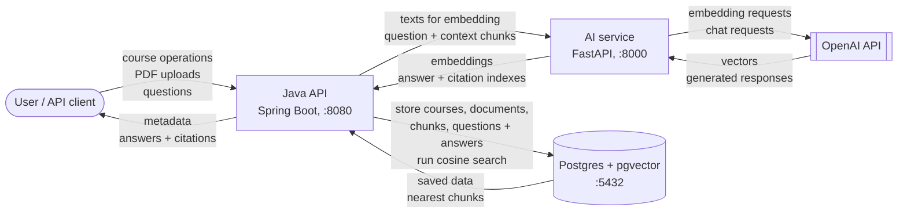

# NoteStream

Upload your course PDFs, then ask questions about them and get answers with citations back to the source material. It's a small retrieval-augmented-generation (RAG) setup: the PDFs get split into chunks, each chunk is turned into a vector, and a question is answered by pulling the closest chunks and handing them to an LLM.

I built it to get hands-on with vector search and to keep a Java service and a Python service talking to each other in a way that's actually reproducible.

## How it fits together



- **Java API** handles courses, PDF ingestion, and the question/answer flow. It parses PDFs, stores chunks, and runs the vector similarity search.
- **AI service** is a thin Python wrapper around OpenAI. It does two things: turn text into embeddings, and answer a question given some context chunks.
- **Postgres/pgvector** holds everything and does the nearest-neighbour search with the `<=>` cosine operator.

Splitting the AI part into its own service keeps the OpenAI-specific code out of the Java side. If I ever swap OpenAI for a local model, only the Python service changes.

## Running it

You only need Docker. No local Java, Python, or Postgres install.

```bash
git clone <repo-url>
cd notestream
cp .env.example .env        # then put a real OpenAI key in it
docker compose up --build
```

First run pulls images and downloads dependencies, so give it a few minutes. After that the API is on `http://localhost:8080`.

The database schema is created automatically on startup by Flyway (`backend-java/src/main/resources/db/migration`), including the pgvector extension. Data lives in a Docker volume and survives restarts. To start from a clean database:

```bash
docker compose down -v
```

## API

Base URL `http://localhost:8080`.

Courses

- `POST   /api/courses` - create a course (`{"name": "...", "description": "..."}`)
- `GET    /api/courses` - list courses
- `GET    /api/courses/{id}` - one course
- `DELETE /api/courses/{id}` - delete a course and its documents

Documents

- `POST /api/courses/{courseId}/documents` - upload a PDF (multipart, field `file`, max 10 MB)
- `GET  /api/courses/{courseId}/documents` - list a course's documents
- `GET  /api/documents/{documentId}` - document metadata
- `GET  /api/documents/{documentId}/chunks` - the chunks a document was split into

Questions

- `POST /api/courses/{courseId}/questions` - ask a question (`{"question": "..."}`), returns the answer and cited chunks
- `GET  /api/courses/{courseId}/questions` - past questions and answers for a course

Health

- `GET /health` - API health (the Java service and the AI service each expose one)

## What happens on upload

1. The PDF is streamed page by page and split into ~500-character chunks on sentence boundaries, with a small overlap so context isn't cut mid-thought.
2. Each chunk is saved, then sent to the AI service to get a 1536-dimension embedding.
3. Embeddings are stored on the chunk rows for later search.

## What happens on a question

1. The question is embedded.
2. Postgres returns the closest chunks in that course by cosine distance.
3. Those chunks plus the question go to the AI service, which asks the LLM to answer using only that context and to cite chunks by number.
4. The cited chunk numbers are mapped back to real chunks and stored with the answer.

## Stack

- Java 21, Spring Boot 3.4, Spring Data JPA
- PostgreSQL 16 with the pgvector extension
- Flyway for schema migrations
- Apache PDFBox for PDF text extraction
- Python 3.13, FastAPI, OpenAI SDK (embeddings + chat)
- Docker Compose to run all three together

## Notes and limits

- You need your own OpenAI API key, and calls to it cost money.
- Embeddings use `text-embedding-3-small` (1536 dimensions). If you change the embedding model, the vector column dimension has to match.
- The database credentials in `docker-compose.yml` are fine for local use but are not meant for anything public.
- Uploads are capped at 10 MB per PDF.
